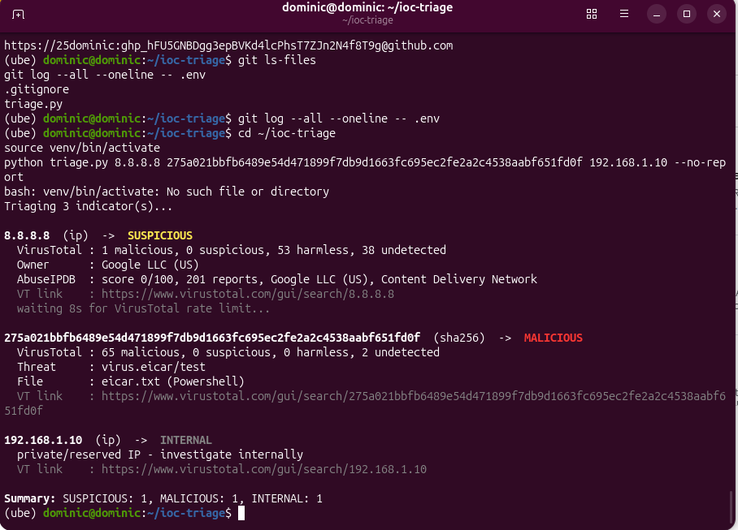
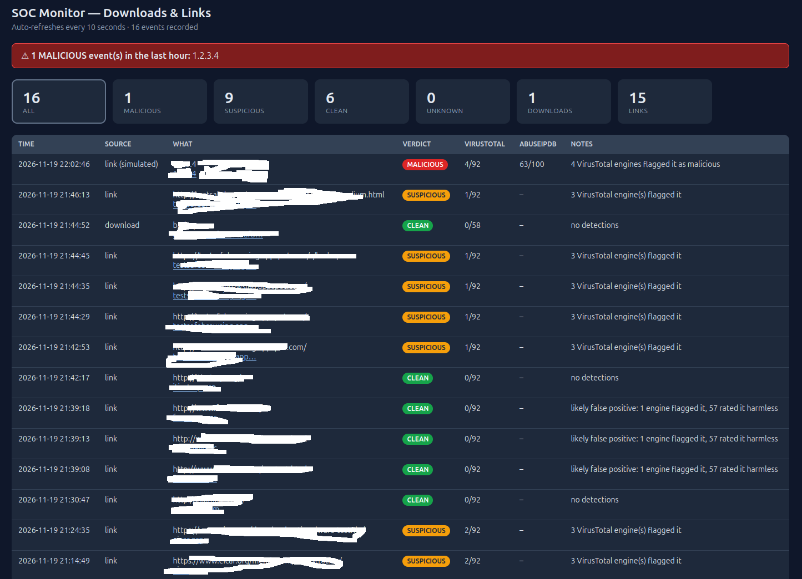

# IOC Triage Tool + Endpoint Monitor

A Python toolkit that automates the first steps of SOC alert triage: checking indicators of compromise (IOCs) against threat intelligence, scoring them with tunable detection rules, and showing the results on a live dashboard.

It has three parts:

| File | What it does |
|---|---|
| `triage.py` | Checks IPs, domains, URLs and file hashes against **VirusTotal** and **AbuseIPDB**, and returns a verdict with a reason |
| `monitor.py` | Watches the machine for **new downloads** and **websites visited in Firefox**, and triages each one automatically |
| `dashboard.py` | A local web dashboard showing every event, verdict counts and alerts for malicious activity |





---

## Why I built this

Tier 1 SOC analysts check the same kinds of indicators many times a day: a suspicious IP in a firewall alert, a domain from a phishing email, a file hash from an EDR detection. Doing this by hand means copying each value into several websites one at a time.

This project automates those lookups, then goes a step further: it watches for new downloads and visited links, enriches them with threat intelligence, and raises alerts, the same collect → enrich → alert flow used by EDR and SIEM platforms.

---

## Features

**Triage**
- **Detects indicator type automatically**: IPv4/IPv6, domains, URLs, and MD5 / SHA-1 / SHA-256 hashes
- **Handles defanged indicators**: `hxxp://evil[.]com` is converted back to `http://evil.com` before lookup
- **Explains every verdict**: each result includes the reason it was given
- **Skips private IPs**: internal addresses are flagged for internal investigation and never sent to external services
- **Bulk mode and CSV reports** for documentation

**Monitoring and dashboard**
- **Download monitoring**: new files in `~/Downloads` are hashed (SHA-256) and checked; unfinished downloads are skipped
- **Link monitoring**: new websites visited in Firefox are checked by domain
- **Desktop alerts** for MALICIOUS and SUSPICIOUS events
- **Live dashboard** with verdict counts, filtering, a malicious-activity banner, and auto-refresh
- **Allowlist and 24-hour cache** to stay within free API limits
- **Simulation mode** to test with known-bad indicators without visiting dangerous sites

**Security practices**
- API keys loaded from a `.env` file and kept out of the code and Git
- Event history (`events.db`) excluded from Git
- Dashboard only reachable from the local machine (`127.0.0.1`), with all page content escaped

---

## Verdict logic

Rules are checked in order, from most to least serious. Every verdict comes with a plain-English reason.

| # | Verdict | Rule |
|---|---|---|
| 1 | **MALICIOUS** | 3+ VirusTotal engines flag it as malicious, **or** AbuseIPDB confidence score ≥ 75 |
| 2 | **CLEAN** | Whitelisted by AbuseIPDB as a known legitimate service (and abuse score < 25) |
| 3 | **CLEAN** | Likely false positive: only 1 engine flagged it while 20+ rated it harmless |
| 4 | **SUSPICIOUS** | 1+ VirusTotal engine flags it, **or** AbuseIPDB score ≥ 25 |
| 5 | **CLEAN** | Results returned and nothing was flagged |
| 6 | **UNKNOWN** | No results (e.g. a new file VirusTotal has never seen) |
| – | **INTERNAL** | Private or reserved IP address; never sent to external services |

All thresholds are constants at the top of `triage.py`, so they can be tuned.

### Tuning example: the 8.8.8.8 false positive
Google's public DNS server (8.8.8.8) was originally marked **SUSPICIOUS** because 1 of 92 VirusTotal engines flagged it, even though 53 rated it harmless and AbuseIPDB scored it 0/100. Rules 2 and 3 were added so that known services and lone detections no longer create noise, while strong evidence (rule 1) still always wins.

---

## Setup

Tested on Ubuntu (VMware VM) with Python 3 and Firefox.

```bash
git clone https://github.com/25dominic/comp-triage.git
cd comp-triage
python3 -m venv venv
source venv/bin/activate
pip install requests python-dotenv flask
```

Create a `.env` file with your free API keys from [VirusTotal](https://www.virustotal.com) and [AbuseIPDB](https://www.abuseipdb.com):

```
VT_API_KEY=your_virustotal_key
ABUSEIPDB_API_KEY=your_abuseipdb_key
```

---

## Usage

### Triage indicators manually

```bash
python triage.py 8.8.8.8
python triage.py google.com hxxp://bad[.]site/login 44d88612fea8a8f36de82e1278abb02f
python triage.py -f iocs.txt          # bulk mode, one indicator per line
python triage.py 8.8.8.8 --no-report  # don't save a CSV
```

### Run the monitor and dashboard

Terminal 1:
```bash
python dashboard.py
```
Then open http://127.0.0.1:5000

Terminal 2:
```bash
python monitor.py
```

Now download a file or visit a website in Firefox, and it appears on the dashboard within seconds.

### Test safely

```bash
# Simulate visiting a known-bad domain or IP without actually visiting it
python monitor.py --simulate-link bad-domain.example

# Check a file as if it had been downloaded
python monitor.py --simulate-file /path/to/file
```

The [EICAR test file](https://www.eicar.org) is a harmless file that antivirus engines flag on purpose. Downloading it is a safe way to trigger a MALICIOUS alert.

---

## Limitations

- Watches a single machine, only Firefox, and only the Downloads folder
- Links are checked by **domain**, so a malicious page hosted on a trusted domain (e.g. a file-sharing site) can come back CLEAN
- New or rare files are often **UNKNOWN** because VirusTotal has never seen them
- The free VirusTotal API allows 4 lookups per minute and is not licensed for commercial use

In a production SOC, this collection is done by EDR agents, DNS and proxy logs feeding a SIEM; this project is a small-scale model of that pipeline.

---

## Skills demonstrated

- **Threat intelligence enrichment** with VirusTotal and AbuseIPDB
- **Detection engineering**: writing, testing and tuning verdict rules to reduce false positives
- **Endpoint monitoring**: file hashing, download detection and browser history analysis
- **Python**: REST APIs, JSON, regex, SQLite, Flask, argument parsing, CSV output
- **Security best practices**: secrets management, keeping private data out of version control, output escaping
- **Linux**: built and tested on Ubuntu in a VMware virtual machine

---

## Planned improvements

- [ ] Check full URLs as well as domains
- [ ] Read DNS logs (e.g. Pi-hole) to see visits from every device on the network
- [ ] Send events to a SIEM such as Wazuh or Splunk
- [ ] Add AlienVault OTX as a third intelligence source
- [ ] Add a login to the dashboard

---

## Disclaimer

This project is for educational and defensive purposes and should only be run on devices you own or are authorized to monitor. Threat intelligence results should support an analyst's judgment, not replace it.
